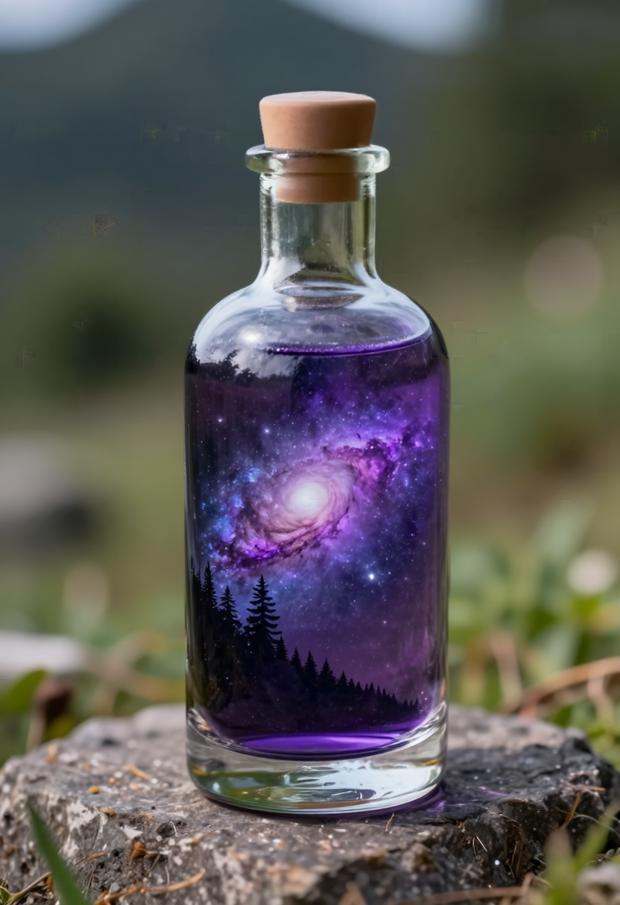
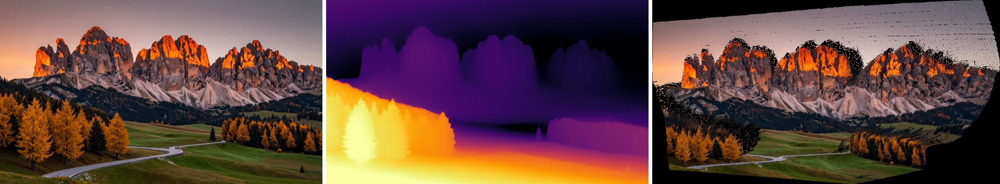

# Iris-3B Comfy Nodes

<p align="center">
  <a href="#install"></a>
  <a href="#workflows"></a>
  <a href="#models"></a>
  <a href="#nodes"></a>
  <a href="#image-to-image"></a>
  <a href="#depth"></a>
  <a href="#upscale"></a>
  <a href="#speed"></a>
  <a href="#contributing"></a>
</p>

ComfyUI nodes for [Iris-3B](https://huggingface.co/speridlabs/iris-3b), a 3B pixel-space text-to-image model from Sperid Labs, plus its 4x upscaler and depth model. Iris has no VAE, so everything goes straight to IMAGE.

**Fast:** about 1.5x faster than the other Iris node pack on a fresh start, and 4x to 9x faster on repeat runs on a 16 GB card, using about 5 GB less VRAM. [Numbers below.](#speed)

<p align="center">
  
  
</p>

<p align="center">
  
  
</p>

Top left: 832x1216 at 50 steps, then the 4x upscaler (3328x4864). Top right: ComfyUI's classic bottle prompt. Bottom: their depth maps from the Iris depth model, grayscale and inferno. Every PNG here has its workflow embedded, so drag [`fox_girl.png`](assets/fox_girl.png), [`bottle.png`](assets/bottle.png), [`fox_girl_depth.png`](assets/fox_girl_depth.png) or [`bottle_depth.png`](assets/bottle_depth.png) into ComfyUI to get the exact graph and settings.

## Install

Search for **Iris-3B** in ComfyUI-Manager, or clone into `ComfyUI/custom_nodes`:

```
git clone https://github.com/bani4kaskashka/Iris-3B-Comfy-Nodes
```

Nothing else to install. It needs transformers 4.57 or newer, which recent ComfyUI already has.

## Workflows

Download one and drag it into ComfyUI, or open it from Templates once the pack is installed.

- [Iris-3B Text to Image (Simple)](example_workflows/Iris-3B%20Text%20to%20Image%20%28Simple%29.json): resolution and quality presets
- [Iris-3B Text to Image (Advanced)](example_workflows/Iris-3B%20Text%20to%20Image%20%28Advanced%29.json): every sampler setting
- [Iris-3B Image to Image](example_workflows/Iris-3B%20Image%20to%20Image.json): restyle or rework an image you load
- [Iris-3B Upscale 4x](example_workflows/Iris-3B%20Upscale%204x.json): 4x upscale of any image
- [Iris-3B Depth](example_workflows/Iris-3B%20Depth.json): depth map of any image, plus a 3D view you can orbit

Both text-to-image workflows end with a 4x upscale group (1024 to 4096) that's bypassed by default. Select the group and press Ctrl+B to turn it on.

## Models

When a workflow opens with a model missing, ComfyUI lists it under Missing Models with a Download button. The loaders also download anything still missing on first run, so you only fetch what your workflow uses (about 44 GB for everything), so the workflows run as-is either way.

```
models/diffusion_models/iris-3b.safetensors            text to image (12 GB)
models/diffusion_models/iris-3b-upscaler.safetensors   4x upscaler (12 GB)
models/diffusion_models/iris-3b-depth.safetensors      depth (12 GB)
models/text_encoders/Qwen3-VL-4B-Instruct/             text encoder, the whole HF repo (8.3 GB)
```

To get them yourself, the three Iris files are `model.safetensors`, `upscaler/model.safetensors` and `depth/model.safetensors` from [speridlabs/iris-3b](https://huggingface.co/speridlabs/iris-3b), renamed as above. The configs come with this pack.

```
hf download Qwen/Qwen3-VL-4B-Instruct --local-dir models/text_encoders/Qwen3-VL-4B-Instruct
```

The text encoder has to be the original HF folder. Single-file or fp8 Qwen3-VL text encoders won't work, because Iris reads 12 hidden layers from it.

## Nodes

- **Load Iris-3B Model**: loads the DiT. `bf16` uses 6 GB of VRAM. `fp32` is the shipped precision but needs a lot more than 16 GB.
- **Load Iris Text Encoder (Qwen3-VL-4B)**: lists HF folders in `text_encoders`.
- **Iris Text Encode**: positive and negative prompt. Leave the negative empty to use the null prompt the model was trained with.
- **Iris Sampler (Simple)**: mode (text to image or image to image), resolution (1 MP sizes from 21:9 to 9:21, or match the input image), quality (fast = 30 steps, balanced = 50, best = 100), prompt adherence (cfg 2, 3 or 4.5), image strength (denoise 0.3, 0.5 or 0.7), seed and batch size.
- **Iris Sampler (Advanced)**: every setting: steps, cfg, seed, batch size, mode, denoise, shift, solver order, CFG interval, any width/height in multiples of 16, and keep_model_on_gpu.
- **Load Iris Upscaler** and **Iris Upscale**: Iris fine-tuned for restoration and 4x upscaling. It's a single pass per 1024 px tile with overlapping tiles and a wavelet color fix. It works on any IMAGE, not just Iris output. With `limit_input_size` on, big inputs are shrunk first (short side 512, long side 1024), so the output stays at or under 2048x4096. Turn it off for a full 4x of any size.
- **Load Iris Depth Model** and **Iris Depth**: Iris fine-tuned for monocular depth, one pass per image. Outputs a depth IMAGE (near = white, ready for depth ControlNets, or an inferno colormap) and the same map as a MASK. It's relative depth, not metric, scaled to each image's 2nd to 98th percentile. `max_side` caps the size the model sees (default 1024).
- **Iris Depth to 3D**: turns the depth into a colored point cloud or mesh (`.ply` in your output folder). Connect it to ComfyUI's **Preview 3D** to orbit around it. `fov` is the photo's assumed field of view.

Both samplers use DPM-Solver++ on the flow schedule. The defaults match the model card (cfg 3, shift 4). Live previews follow ComfyUI's preview setting and cost nothing, since Iris predicts pixels directly.

### Image to image

Set the sampler's mode to image to image and connect an IMAGE. The image is noised partway and diffused back, so lower strength keeps more of it. It takes the same time as a normal run with the same steps.

Source, then subtle (0.3), medium (0.5) and strong (0.7), prompted as an oil painting:


### Depth


The Depth workflow also builds a 3D point cloud and opens it in Preview 3D. Click Fit to Viewer, then drag to orbit and scroll to zoom. Photo, depth and the 3D view:



### Upscale

Bicubic on the left, Iris 4x on the right:


## Speed

Measured on an RX 9060 XT (16 GB, ROCm on Windows), 1 MP images, against [the other Iris node pack](https://github.com/envy-ai/ComfyUI-Iris) with its default settings:

| | This pack | Other pack |
|---|---|---|
| First run | 1.8 s/step | 2.8 s/step |
| Second run | 1.8 s/step | 7.3 s/step |
| Third run | 1.8 s/step | 16.4 s/step |
| Peak VRAM | 7.7 GB | 12.5 GB |

Each model here visits the GPU only for its own step and sits in system RAM otherwise, so nothing piles up and spills over on a 16 GB card. Expect to need around 22 GB of free system RAM with all three models loaded. 4x upscaling 1024 to 4096 is 49 tiles, about 47 s.

On AMD, start ComfyUI the normal way (`main.py`), which turns on the AOTriton flash attention kernels. Without them attention falls back to a slow path.

## Contributing

Got a fix, a new feature or support for another Iris model? Open a pull request here instead of starting a separate repo. This pack is the one on ComfyUI-Manager and the Comfy Registry, so anything merged here reaches everyone who has it installed with their next update, and people don't have to pick between packs that conflict with each other.

Bug reports and ideas go in [issues](https://github.com/bani4kaskashka/Iris-3B-Comfy-Nodes/issues).

## Credits

Made by Bucky ([bani4kaskashka](https://github.com/bani4kaskashka)). The model code in `vendor/bucky_iris3b` is from [speridlabs/iris-3b](https://github.com/speridlabs/iris-3b) (Apache-2.0, see `vendor/LICENSE` and `vendor/NOTICE`), renamed so it can't clash with other packs that bundle their own copy. Only the inference parts are included. This pack is also Apache-2.0; if you redistribute it or build on it, keep the `LICENSE` and `NOTICE` files.
